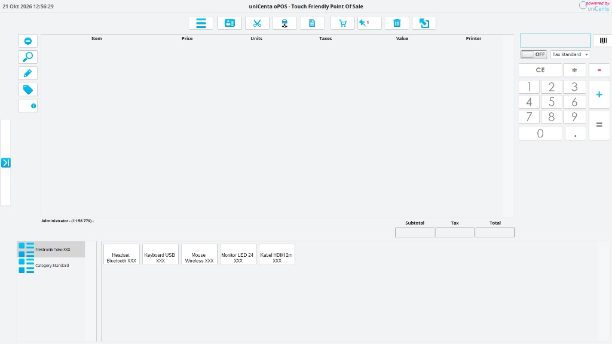
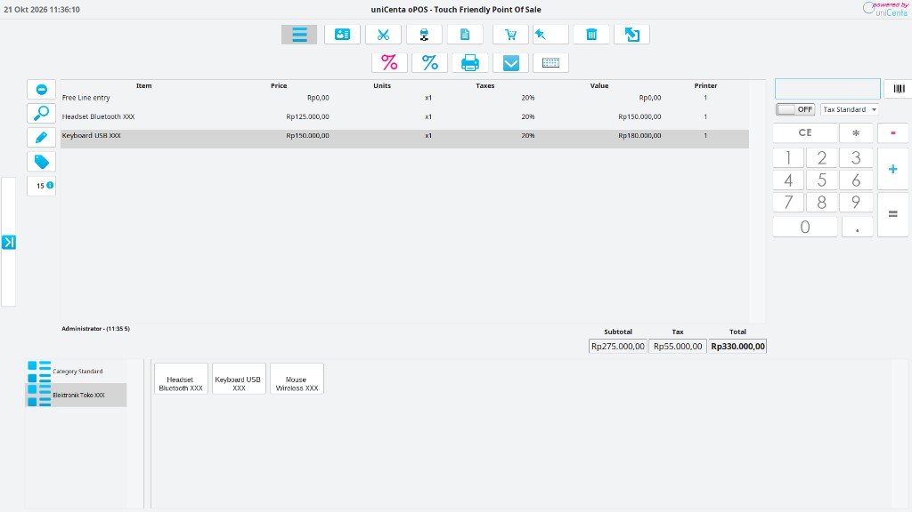
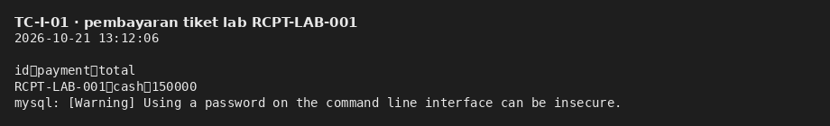
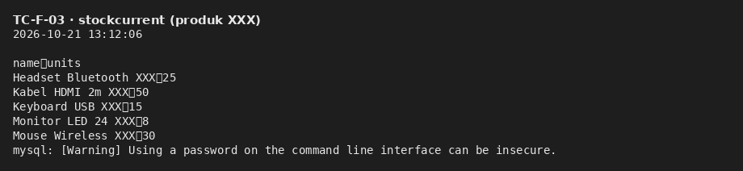
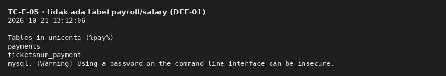
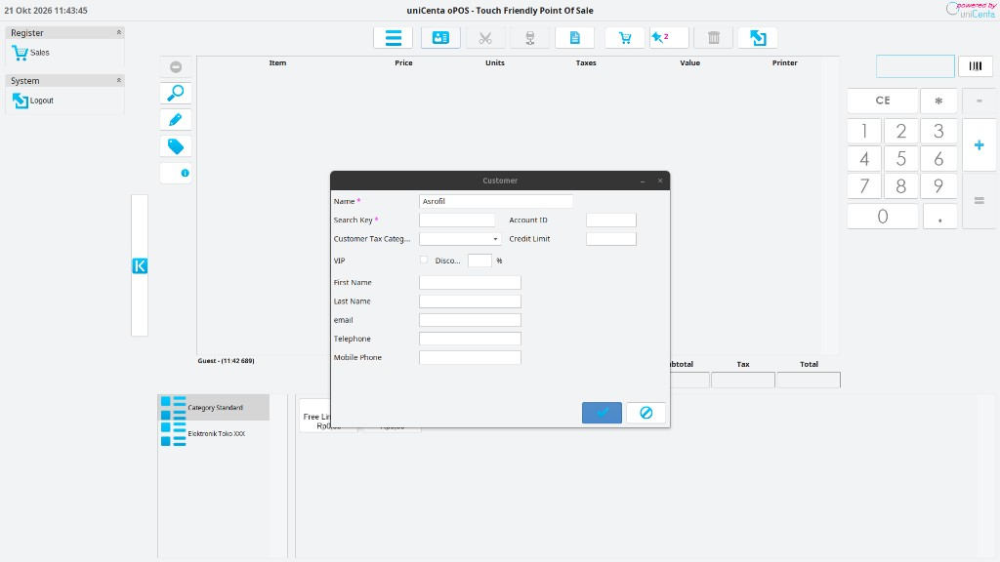
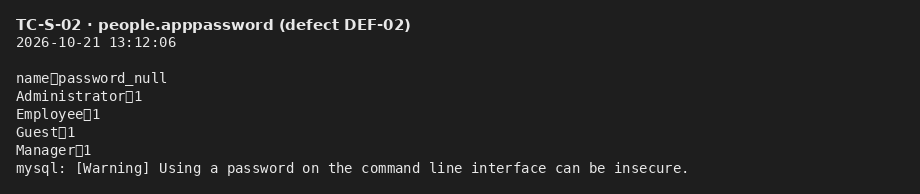
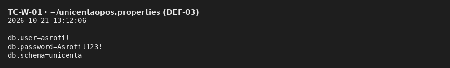

# Lampiran — Bukti uji manual GUI (J.62SQA00.008.1)

**Unit:** J.62SQA00.008.1 — *Melakukan pengujian kualitas perangkat lunak secara manual*  
**SUT:** uniCenta oPOS 5.0 · skema `unicenta` · data **Elektronik Toko XXX**  
**Tanggal:** 21 Oktober 2026  

Proses: setiap kasus = langkah di GUI → bandingkan Expected/Actual → simpan bukti visual. File PNG: [`../bukti/J.62SQA00.008.1-manual/`](../bukti/J.62SQA00.008.1-manual/).

---

## 1. TC-F-01 · POS aktif menggantikan Excel (KAK T01, S01)

| Langkah manual | Field / area yang dicek |
| --- | --- |
| Jalankan `unicenta-opos`, login **Administrator** (password kosong — temuan terpisah TC-S-02) | Dialog login: pilih role, field password |
| Pastikan layar **Sales** terbuka | Grid tiket, keypad, kategori produk |
| Pilih kategori **Elektronik Toko XXX** | Panel kategori kiri bawah |
| Pastikan produk dummy XXX tampil | Tombol Headset, Keyboard, Mouse, Monitor, Kabel HDMI |

**Expected:** Aplikasi desktop POS siap transaksi, bukan Excel.  
**Actual:** Pass — katalog Toko XXX dan peran Administrator terlihat.



---

## 2. TC-F-02 · Pencatatan transaksi di tiket (KAK T02, T03)

| Langkah manual | Field / area yang dicek |
| --- | --- |
| Klik produk (mis. Headset + Keyboard) | Baris **Item, Price, Units, Taxes, Value** terisi |
| Verifikasi **Subtotal, Tax, Total** | Field ringkasan kanan bawah grid |
| (Opsional) Bayar tunai sampai tiket selesai | Dialog payment: metode **cash**, nominal **tendered** |

**Expected:** Transaksi tercatat di antarmuka tanpa Excel.  
**Actual:** Pass — multi-item di tiket, pajak 20% terhitung.



**Integrasi DB (pelengkap TC-I-01):**



---

## 3. TC-F-03 · Stok real time (KAK T04)

| Langkah manual | Field / area yang dicek |
| --- | --- |
| Catat stok lewat DB **sebelum** jual | Kolom `units` per produk XXX |
| Jual 1 unit lewat GUI | Tiket menampilkan produk terjual |
| Jalankan ulang query stok | `units` turun 1 |

**Expected:** Stok berkurang sesuai penjualan.  
**Actual:** Pass — contoh lab headset 20→19; snapshot stok terkini di bawah.



---

## 4. TC-F-05 · Modul gaji (KAK T06) — Fail

| Langkah manual | Field / area yang dicek |
| --- | --- |
| Menu utama → cari **Payroll / Salary / Gaji** | Entri menu backoffice |
| Jika tidak ada, cek skema DB | Tabel `payroll`, `salary`, `gaji` |

**Expected:** Fitur hitung gaji karyawan.  
**Actual:** **Fail** — tidak ada modul; skema tanpa tabel gaji (DEF-01).



---

## 5. TC-F-06 · Peran & data pelanggan (KAK D01)

| Langkah manual | Field / area yang dicek |
| --- | --- |
| Ikon **Customer** di toolbar | Form: **Search Key***, **Name***, Tax Category, telepon, email |
| Isi field wajib (contoh lab) | Search key `ASROFIL`, nama dummy |
| Bandingkan sesi **Administrator** vs **Guest** | Footer kiri: teks role pengguna |

**Expected:** Peran admin/karyawan dapat dibedakan; data pelanggan dapat diinput.  
**Actual:** Pass sebagian peran (4 role di DB); form pelanggan berfungsi; password default tetap temuan TC-S-02.




---

## 6. TC-S-02 / TC-S-03 · Password default kosong (KAK K01) — Fail kritis

| Langkah manual | Field / area yang dicek |
| --- | --- |
| Logout → login **Administrator** | Field **password** dikosongkan → tetap masuk |
| Query `people.apppassword` | Semua baris `password_null = 1` |

**Expected:** Password wajib, tidak NULL.  
**Actual:** **Fail kritis** (DEF-02).



---

## 7. TC-W-01 · Kredensial DB di berkas konfigurasi (KAK K01) — Fail

| Langkah manual | Field / area yang dicek |
| --- | --- |
| Buka `~/unicentaopos.properties` | Baris `db.password=`, `db.user=`, `db.schema=` |

**Expected:** Rahasia tidak disimpan polos.  
**Actual:** **Fail** — password DB terbaca polos (DEF-03).



---

## Regenerasi bukti

```bash
~/Project/personal/ujikom_sqa/install/scripts/render-terminal-bukti.sh
# Screenshot GUI: saat uniCenta fokus, pakai Flameshot / Shutter ke folder bukti dengan nama TC-*.png
```
